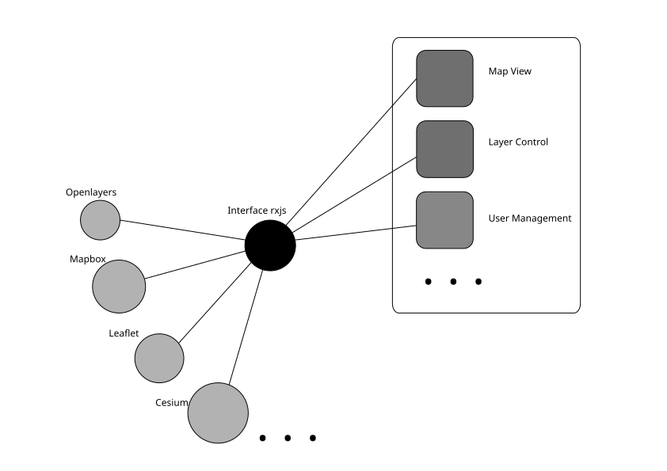

# @dlr-eoc/services-layers


## The idea of the LayersService

It should be an interface to use our components with different mapping libraries e.g. OpenLayers, Cesium, Leaflet, MapLibre
For example one layer control which is working with all the different maps and layertypes. 
The conversion from our generalized layers to the map specific should be implemented in the corresponding component like in @dlr-eoc/map-ol 



### how to use this in a ukis-angular project
```
import { LayersService } from '@dlr-eoc/services-layers';
```

```
constructor(public layersSvc: LayersService,...)
```

```
ngOnInit(){
  this.layersSvc.addLayer(layer, 'Baselayers');
}
```

It implements the base of handling ukis-layers and defines classes and types for Layers, LayerGroups, RasterLayers... 
There are actually three slots ('Baselayers' | 'Overlays' | 'Layers') to push layers so we can create a flat layer tree from that to give it to the corresponding map component. So if the mapping library does not handle groups it should also work.


The main functions you will work with are:
- addLayer
- updateLayer
- removeLayer

- addLayerGroup
- updateLayerGroup
- removeLayerGroup

- removeLayerOrGroupById
- getLayerOrGroupById


For examples see:
- [demo maps](../demo-maps/README.md)
- [layer-control](../layer-control/src/lib/base-layer-control/base-layer-control.component.ts)


This module is used by components like:
- @dlr-eoc/ngx-ukis-ui-clarity (layer-control)
- @dlr-eoc/base-layers-raster
- ...


===

This project was generated using [Angular CLI](https://github.com/angular/angular-cli) version 22.1.0.